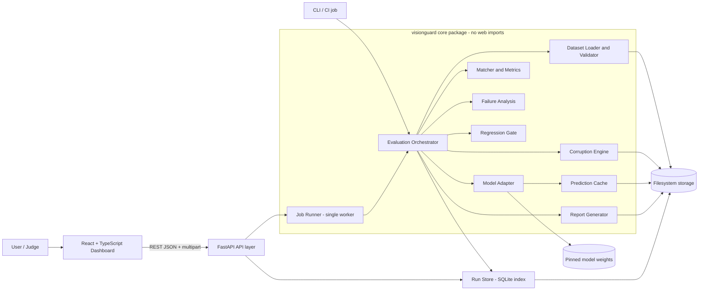
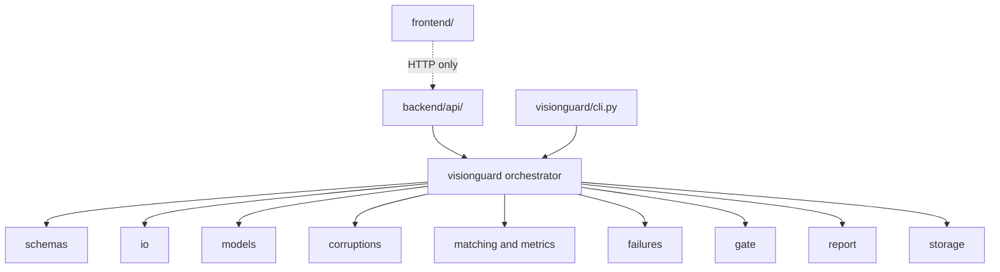
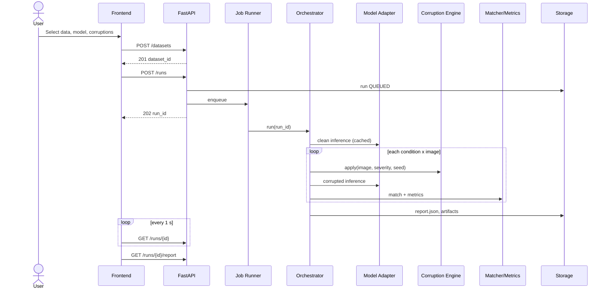
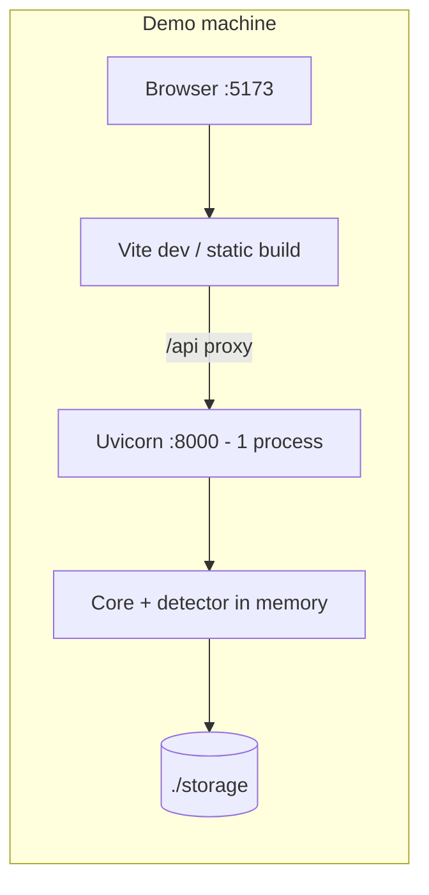

# 03 — System Architecture

| Field | Value |
| --- | --- |
| Version | 1.0 (Draft) · 24 Oct 2026 |
| Owner | Tanish + all module owners |
| Stage | 1 |
| Basis | `VisionGuard_SYSTEM_ARCHITECTURE.md` (§1–§7.3 present) + completion of §8–§15 |

> **Status:** every component is `PLANNED`. This is a proposed architecture, not an implemented one. Items tagged **`[PROPOSED]`** were not in the uploaded (truncated) architecture file and need team review.

Answers one question: **how will the entire software system be built?**

---

## 1. High-level architecture

Style: **modular monolith** — one backend process, one frontend, and a framework-free Python core package imported by both the API and the CLI. No microservices, queues or Kubernetes in the MVP.



## 2. Technology stack

| Layer | Choice | Note |
| --- | --- | --- |
| Frontend | React + TypeScript + Vite; Recharts; Tailwind **or** CSS modules (pick one) | Types generated from OpenAPI |
| Backend | Python, FastAPI, Pydantic, Uvicorn, `python-multipart` | Single worker process |
| Image/numeric | OpenCV, Pillow, NumPy, SciPy | Hungarian matching via SciPy |
| Detector | Pretrained YOLO-family nano via adapter | Pin package + weights; AGPL-3.0 note (ADR-05) |
| Metrics | `pycocotools` (or TorchMetrics) for mAP | No custom "mAP" |
| Persistence | Filesystem + SQLite index | PostgreSQL deferred |
| Testing | pytest, API tests, frontend build/tests | See 08 |
| Packaging | Local venv; Docker Compose optional | Do not introduce on final day untested |

## 3. Component architecture and module responsibilities

| § | Component | Responsibility | Pri | Owner (proposed) |
| --- | --- | --- | --- | --- |
| 5.1 | Frontend | Configure runs, show progress, heatmap, sweep, failure gallery, gate, export | P0 | Vanashree |
| 5.2 | Backend API | Validate (Pydantic), upload, create runs, serve status/report/artifacts, error envelope | P0 | Tanish |
| 5.3 | Orchestrator + Job Runner | Sequencing only: baseline → conditions → aggregate → failures → gate → report | P0 | Tanish |
| 5.4 | Dataset Loader | Validate, EXIF-normalize, RGB uint8, COCO parse, `xyxy` conversion, hashing | P0 | Aditya |
| 5.5 | Model Adapter | Single detector interface; pinned, checksum-verified weights; original-pixel boxes | P0 | Chinmay |
| 5.6 | Corruption Engine | Seeded, pure, resolution-independent corruptions; registry | P0 | Chinmay |
| 5.7 | Matcher & Evaluation | Matching, consistency + ground-truth metrics, bootstrap CIs | P0/P1 | Aditya |
| 5.8 | Failure Analysis | Taxonomy, ranking score, top-K artifact policy | P0 | Aditya + Vanashree (UI) |
| 5.9 | Report Generator | `report.json` (+HTML), limitations text | P0/P1 | Documentation/demo owner |
| 5.10 | Regression Gate | Pure function `evaluate_gate(rules, results)` | P1 | Aditya |
| 5.11 | Run/Artifact Store | SQLite index, `status.json`, opaque artifact IDs, recovery | P0 | Tanish |
| 5.12 | CLI | Same orchestrator, exit codes | P1 | Tanish |

### Dependency rules (enforced in review; optionally `import-linter`)

1. `schemas` imports nothing from the project; everything else imports it.
2. Leaf modules never import each other; only the orchestrator composes them.
3. `visionguard` never imports FastAPI/Starlette; the API imports `visionguard`, never the reverse.
4. The frontend talks to the backend only via REST; never reads the filesystem.
5. Only `models/*_adapter.py` may import a detector library.



### Key interfaces

```python
class DetectorAdapter(Protocol):
    id: str
    def load(self) -> None: ...
    def metadata(self) -> ModelInfo: ...
    def predict(self, image: np.ndarray, params: InferenceParams) -> PredictionResult: ...
    def predict_batch(self, images, params) -> list[PredictionResult]: ...  # optional

class Corruption(Protocol):
    id: str
    family: str                      # blur|noise|illumination|digital|weather|occlusion
    geometry_preserving: bool
    def params_for(self, severity: int, image_shape) -> dict: ...
    def apply(self, image: np.ndarray, severity: int, seed: int) -> CorruptionResult: ...
```

## 4. Data flow



| Stage | Failure behaviour |
| --- | --- |
| Validate request | `422 INVALID_CONFIG`; no run created |
| Validate dataset | 4xx, upload rejected atomically |
| Baseline inference | Run `FAILED`; never fabricate detections |
| Corrupt / corrupted inference | Condition `ERROR`, run continues → `PARTIAL` |
| Metrics | `METRIC_UNAVAILABLE` per metric; others still reported |
| Gate | Rule-level `ERROR` ⇒ overall `ERROR` (never silent PASS) |
| Report | `PARTIAL`, raw artifacts retained |

Run state machine: `QUEUED → RUNNING → COMPLETED | PARTIAL | FAILED | CANCELLED`; `RUNNING` stages: `VALIDATING → BASELINE → CONDITIONS → AGGREGATING → ANALYZING_FAILURES → GATE → REPORTING`.

Cache key: `sha256(model_id ‖ weights_sha256 ‖ inference_params ‖ image_sha256 ‖ corruption_id ‖ normalized_params ‖ derived_seed)`.

## 5. API integration design

Frontend types are generated from FastAPI's OpenAPI document (`openapi-typescript` → `frontend/src/types/api.gen.ts`); hand-written duplicates of API types are not allowed. Full contract in **05**.

## 6. Storage architecture `[PROPOSED]`

```
storage/
├── index.sqlite                 # disposable index of runs (rebuildable from disk)
├── datasets/<dataset_id>/
│   ├── dataset.json             # schema 06 §2
│   └── images/<image_id>.<ext>
├── cache/predictions/<sha256>.json
└── runs/<run_id>/
    ├── config.json              # normalized RunConfig
    ├── status.json              # state, stage, done/total, error
    ├── report.json              # authoritative result
    ├── report.html              # optional
    ├── artifacts.json           # artifact_id -> relative path map
    └── artifacts/<artifact_id>.png
```

- **Filesystem is the source of truth.** SQLite `runs` table stores only `run_id, created_at, status, model_id, dataset_id, gate_verdict` for listing.
- Artifact IDs are opaque, server-generated; clients never send paths.
- Startup recovery: runs whose `status.json` says `RUNNING` become `FAILED/INTERRUPTED`; rebuild the index if missing.
- `storage/`, weights, datasets and uploads are git-ignored.

## 7. Regression gate architecture `[PROPOSED]`

Pure, I/O-free function: `evaluate_gate(rules, results) -> GateResult`.

```yaml
# gate.yaml
rules:
  - id: retention-floor
    metric: retention
    scope: {corruption: gaussian_blur, severity: 2}   # or "any" / "all conditions"
    op: ">="
    threshold: 0.80
  - id: map-drop
    metric: relative_map50
    scope: all
    op: ">="
    threshold: 0.70
```

Verdict: `PASS` all rules pass · `FAIL` ≥ 1 rule fails · `ERROR` a rule cannot be evaluated (undefined metric, failed condition, partial run). Thresholds are user-supplied; VisionGuard ships no "safe" defaults. Result carries per-rule `{rule_id, observed, threshold, op, outcome, evidence}`.

## 8. Error handling and logging `[PROPOSED]`

Error envelope (all non-2xx):

```json
{ "error": { "code": "INVALID_CONFIG", "message": "Human-readable text",
             "details": [ { "field": "corruptions[0].severities[1]", "issue": "must be 1..3" } ],
             "request_id": "req_01J..." } }
```

| HTTP | Codes |
| --- | --- |
| 400 | `INVALID_IMAGE`, `UNSUPPORTED_FORMAT`, `INVALID_ANNOTATION`, `INVALID_ARCHIVE` |
| 404 | `DATASET_NOT_FOUND`, `MODEL_NOT_FOUND`, `RUN_NOT_FOUND`, `ARTIFACT_NOT_FOUND` |
| 409 | `RUN_NOT_CANCELLABLE`, `RUN_NOT_COMPLETE` |
| 413 | `IMAGE_TOO_LARGE`, `DATASET_TOO_LARGE` |
| 422 | `INVALID_CONFIG`, `METRIC_UNAVAILABLE`, `UNKNOWN_CORRUPTION`, `INVALID_SEVERITY`, `CLASS_MAP_EMPTY` |
| 500 | `INFERENCE_FAILED`, `CORRUPTION_FAILED`, `REPORT_BUILD_FAILED`, `INTERNAL` |
| 503 | `MODEL_UNAVAILABLE`, `RESOURCE_EXHAUSTED` |

Stack traces are never returned; they go to logs. Structured JSON logs include `run_id`, `stage`, `condition_id`. Full images are never logged.

## 9. Security architecture

Master Plan §K plus architecture rules:

- Limit upload size, pixels, formats, conditions per request; verify magic bytes.
- Decode with robust libraries; catch malformed-image errors.
- Server-generated artifact IDs/filenames; never concatenate untrusted names into paths.
- No user-supplied model paths, code, URLs or shell commands; weights loaded from pinned, checksum-verified location only.
- Zip safety: reject `..`, absolute paths, symlinks, zip-bombs (uncompressed size and entry caps).
- CORS limited to configured origins.
- No authentication in MVP; if ever deployed publicly, add authentication and rate limiting first.
- Retention/cleanup policy for `storage/`; disclose what is stored.
- Respect model and dataset licenses.

## 10. Deployment architecture

Lowest risk: run everything locally with preloaded weights and prepared samples.



**Do not** run Uvicorn with multiple worker processes: job state and the loaded model live in one process. Detector is loaded once at startup; `/health` reports `model_loaded`. Windows compatibility required. Docker Compose optional and only if already tested. Local fallback required if Wi-Fi or hosted inference fails.

## 11. Testing architecture

See 08. Layers: unit → integration → API → model → corruption → metric → UI → end-to-end, plus a shared known-good fixture under `backend/tests/fixtures/`.

## 12. Architecture decisions and trade-offs

See `ADR/`. Summary:

| ADR | Decision | Trade-off |
| --- | --- | --- |
| 01 | Modular monolith | Less scale, far less integration risk |
| 02 | Framework-free core + thin API | Extra package boundary; CLI/CI reuse |
| 03 | Dataset-oriented runs (image = dataset of one) | Two-step upload; single code path |
| 04 | Filesystem truth + SQLite index | No rich queries; trivially recoverable |
| 05 | Detector behind adapter (Ultralytics first) | AGPL-3.0 licensing note |
| 06 | Two metric families, never mixed | More UI complexity; honest reporting |
| 07 | Pydantic → OpenAPI → generated TS types | Build step; no contract drift |

## 13. Team ownership

See 09 §2 and the component table above. Changes to shared schemas (06) or API (05) require the approvals in 09 §9.

## 14. Architecture approval checklist (gate before parallel coding)

- [ ] High-level architecture diagram approved
- [ ] Component responsibilities assigned
- [ ] Common prediction schema finalized (06 §4)
- [ ] Dataset/annotation format finalized (COCO JSON, 06 §2–§3)
- [ ] API contracts agreed (05) and fixtures committed to `backend/tests/fixtures/`
- [ ] Core evaluation workflow agreed (07)

## 15. Repository layout (target)

```
visionguard/
├── README.md  .gitignore  .env.example  docker-compose.yml (optional)
├── docs/
├── backend/
│   ├── pyproject.toml
│   ├── api/                     # FastAPI app, thin routes
│   │   ├── main.py  config.py
│   │   └── routes/ (health, models, corruptions, presets, datasets, runs, reports)
│   ├── visionguard/             # core package, no web imports
│   │   ├── schemas/  io/  models/  corruptions/  matching/  metrics/
│   │   ├── failures/  gate/  report/  storage/
│   │   ├── orchestrator.py  cli.py
│   └── tests/ (unit, integration, fixtures)
├── frontend/ (src/api, src/types/api.gen.ts, components, pages, hooks)
├── samples/
└── storage/                     # git-ignored
```
